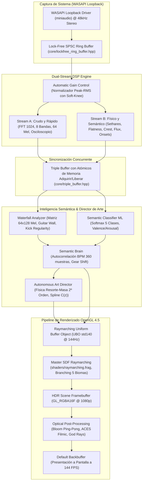
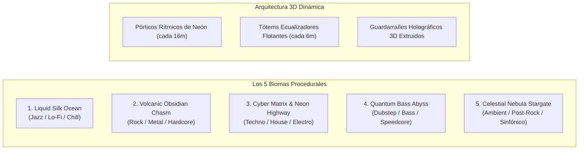

# AUDIO VOYAGER: MANUAL DE ARQUITECTURA Y SISTEMAS COMPLETOS
> **Versión del Documento:** 2.5 (Edición para Equipos de Ingeniería)  
> **Fecha de Actualización:** 2026-10-26  
> **Tecnologías Centrales:** C++20, OpenGL 4.5 Core Profile, GLSL 450, WASAPI / Miniaudio, CMake, Ninja, MinGW-w64, Docker.

---

## ÍNDICE DE CONTENIDOS
1. [Visión General y Filosofía del Motor](#1-visión-general-y-filosofía-del-motor)
2. [Arquitectura General del Sistema](#2-arquitectura-general-del-sistema)
3. [Módulo 1: Captura de Audio y DSP de Doble Flujo (Stream A / Stream B)](#3-módulo-1-captura-de-audio-y-dsp-de-doble-flujo)
4. [Módulo 2: Inteligencia Semántica y Motor Waterfall (Mind & Muscle)](#4-módulo-2-inteligencia-semántica-y-motor-waterfall)
5. [Módulo 3: Director de Arte Cinemático y Motor Físico de 2º Orden](#5-módulo-3-director-de-arte-cinemático-y-motor-físico-de-2º-orden)
6. [Módulo 4: Motor de Renderizado Raymarching SDF (GPU Pipeline)](#6-módulo-4-motor-de-renderizado-raymarching-sdf)
7. [Módulo 5: Catálogo de Biomas y Arquitectura Procedural 3D](#7-módulo-5-catálogo-de-biomas-y-arquitectura-procedural-3d)
8. [Módulo 6: Postprocesado Óptico HDR y Cámara Cinemática](#8-módulo-6-postprocesado-óptico-hdr-y-cámara-cinemática)
9. [Módulo 7: Telemetría y Debug HUD (ImGui F12)](#9-módulo-7-telemetría-y-debug-hud)
10. [Módulo 8: Infraestructura de Compilación y Suite de Tests](#10-módulo-8-infraestructura-de-compilación-y-suite-de-tests)
11. [Guía para el Desarrollador: Extensión de Nuevos Biomas y Features](#11-guía-para-el-desarrollador)

---

## 1. Visión General y Filosofía del Motor

**Audio Voyager** es un visualizador musical procedural en 3D en tiempo real de latencia ultra-baja (< 0.05 ms en ruta rápida), concebido bajo un principio inquebrantable:
> **"Cero animaciones scripteadas pre-horneadas: toda la geometría, curvatura, velocidad, iluminación, cámara y relieves del mundo son el resultado directo y determinista de las físicas y la semántica del audio."**

A diferencia de los visualizadores clásicos que se limitan a un ecualizador de barras 2D o a túneles con curvas sinusoidales fijas, Audio Voyager analiza la música en dos niveles concurrentes:
1. **El Músculo (Física Acústica Inmediata):** Detecta transitorios, sobrepresión de graves, densidad espectral y disparos percutivos a 144 Hz para generar impactos físicos, dilatación de cavidades y rebotes de suspensión.
2. **La Mente (Comprensión Semántica y Espaciotemporal):** Utiliza un búfer de historia espectral 2D (Waterfall de 64 bandas Mel $\times$ 128 cuadros) y un clasificador neuronal determinista para identificar género (Jazz/Liquid, Metal, Techno/Cyber, Dubstep, Celestial/Ambient), tempo real (BPM), regularidad rítmica (4-on-the-floor vs. sincopado) y coordenadas afectivas (Arousal / Valence).

---

## 2. Arquitectura General del Sistema

El flujo de ejecución está estrictamente desacoplado entre el hilo de audio de alta prioridad y el hilo principal de renderizado GPU mediante búferes libres de bloqueos (*lock-free*):



---

## 3. Módulo 1: Captura de Audio y DSP de Doble Flujo

Archivos de implementación:
* [`src/audio/audio_capture.hpp`](file:///c:/chamba/repos%20git/audio-voyager/src/audio/audio_capture.hpp) / [`src/audio/audio_capture.cpp`](file:///c:/chamba/repos%20git/audio-voyager/src/audio/audio_capture.cpp)
* [`src/audio/miniaudio_impl.cpp`](file:///c:/chamba/repos%20git/audio-voyager/src/audio/miniaudio_impl.cpp)
* [`src/audio/stream_a_raw.hpp`](file:///c:/chamba/repos%20git/audio-voyager/src/audio/stream_a_raw.hpp) / [`src/audio/stream_a_raw.cpp`](file:///c:/chamba/repos%20git/audio-voyager/src/audio/stream_a_raw.cpp)
* [`src/audio/stream_b_physics.hpp`](file:///c:/chamba/repos%20git/audio-voyager/src/audio/stream_b_physics.hpp) / [`src/audio/stream_b_physics.cpp`](file:///c:/chamba/repos%20git/audio-voyager/src/audio/stream_b_physics.cpp)

### 3.1 Control Automático de Ganancia (AGC) y Normalización
Para evitar que el visualizador se sature con Spotify al 100% de volumen o se vuelva inerte al 30%, se implementó un normalizador adaptativo con saturación de rodilla suave (*soft-knee*):
* **Detector de Envolvente:** Rastreo de pico con ataque rápido ($\tau_{\text{attack}} = 15\text{ ms}$) y decaimiento suave ($\tau_{\text{decay}} = 2.4\text{ s}$).
* **Ganancia Dinámica:** Calibra la señal para llevar el RMS nominal a $0.24$.
* **Saturador C1 continuo:** Si la señal supera el rango nominal, se aplica una curva de rodilla suave:
  $$y = \begin{cases} x & x \le 0.70 \\ 0.70 + 0.30 \cdot \tanh\left(\frac{x - 0.70}{0.30}\right) & x > 0.70 \end{cases}$$
* **Sensibilidad Manual:** Multiplicador configurable en tiempo real desde el HUD `F12` o mediante la rueda del ratón (`input_gain` $\in [0.10\times, 5.00\times]$).

### 3.2 Flujo A: Reactividad Cruda de Ultra-Baja Latencia
* **Búfer de Osciloscopio:** Ventana deslizante de 256 muestras PCM crudas enviadas al renderizador del osciloscopio 3D.
* **Transformada Rápida de Fourier (FFT 1024 puntos):**
  * Ventana de Hann para supresión de lóbulos laterales.
  * Mapeo a **8 bandas de frecuencias musicales estándar**:
    1. *Sub-Bass* (20 – 60 Hz)
    2. *Bass* (60 – 250 Hz)
    3. *Low-Mid* (250 – 500 Hz)
    4. *Mid* (500 – 2000 Hz)
    5. *High-Mid* (2 – 4 kHz)
    6. *Presence* (4 – 6 kHz)
    7. *Brilliance* (6 – 12 kHz)
    8. *Air* (12 – 20 kHz)
* **Banco de Filtros Mel (64 Bandas):** Convierte el espectro lineal a escala psicofísica Mel para alimentar la matriz del analizador Waterfall.

### 3.3 Flujo B: Extracción de Características Físicas y Semánticas
Calcula descriptores avanzados para alimentar el modelo de clasificación musical:
1. **Disonancia Sensorial de Sethares (Normalizada):** Modela la aspereza psicoacústica mediante interacción no lineal entre los armónicos salientes. Mide el choque armónico de notas disonantes (típico de solos de guitarra estridentes o drops agresivos).
2. **Planitud Espectral Acotada (Bounded Spectral Flatness en 300 – 6000 Hz):**
   $$\text{Flatness} = \frac{\exp\left(\frac{1}{N}\sum_{k} \ln S(k)\right)}{\frac{1}{N}\sum_{k} S(k)}$$
   *Calculada estrictamente en el rango musical medio*, evita que el silencio en frecuencias ultra-altas colapse la media geométrica. Permite discriminar guitarras eléctricas saturadas y distorsión analógica ($\text{Flatness} > 0.35$) frente a instrumentos acústicos o sintetizadores sinusoidales puros ($\text{Flatness} < 0.08$).
3. **Factor de Cresta en Medios (Mid-band Crest Factor):** Razón entre pico y RMS en medios ($300 - 3500\text{ Hz}$). Las guitarras comprimidas de heavy metal tienen un factor bajo ($< 1.8$), mientras que el jazz dinámico supera $3.5$.
4. **Flujo Espectral (Spectral Flux):** Detecta la tasa de cambio espectral cuadro a cuadro para medir la turbulencia tímbrica.
5. **Detección de Novedad de Onsets (HFC Onsets):** Ponderación de frecuencias altas para registrar ataques instantáneos de percusión (bombos, redobles, platillos).

---

## 4. Módulo 2: Inteligencia Semántica y Motor Waterfall

Archivos de implementación:
* [`src/brain/waterfall_analyzer.hpp`](file:///c:/chamba/repos%20git/audio-voyager/src/brain/waterfall_analyzer.hpp) / [`src/brain/waterfall_analyzer.cpp`](file:///c:/chamba/repos%20git/audio-voyager/src/brain/waterfall_analyzer.cpp)
* [`src/brain/semantic_classifier_ml.hpp`](file:///c:/chamba/repos%20git/audio-voyager/src/brain/semantic_classifier_ml.hpp) / [`src/brain/semantic_classifier_ml.cpp`](file:///c:/chamba/repos%20git/audio-voyager/src/brain/semantic_classifier_ml.cpp)
* [`src/brain/semantic_brain.hpp`](file:///c:/chamba/repos%20git/audio-voyager/src/brain/semantic_brain.hpp) / [`src/brain/semantic_brain.cpp`](file:///c:/chamba/repos%20git/audio-voyager/src/brain/semantic_brain.cpp)

### 4.1 El Motor Waterfall (Espectrograma Espaciotemporal 2D)
Almacena una matriz circular de **64 bandas Mel $\times$ 128 cuadros temporales** (~2.7 segundos de memoria histórica continua):
* **Continuidad Espectral Horizontal:** Evalúa la persistencia temporal de energía en bandas armónicas para detectar muros sostenidos de distorsión (*Hand of Blood*, *Bring Me The Horizon*) frente a notas punteadas.
* **Cadencia y Regularidad 4-on-the-Floor:** Autocorrelaciona columnas verticales en la zona de bombos ($40 - 120\text{ Hz}$). Si detecta pulsos periódicos equidistantes, bloquea la clasificación en **Cyber/Techno** y rechaza falsos positivos de Dubstep.
* **Flujo Temporal de Graves (LFO Wobble):** Mide la varianza de baja frecuencia; las modulaciones sinusoidales lentas de sintetizador activan el **Dubstep Abyss**.
* **Generación de Textura GPU (`GL_R16F`):** La matriz se transfiere a la GPU como una textura de 64x128 puntos flotantes de 16 bits para esculpir las paredes del túnel en el raymarching.

### 4.2 Clasificador Neuronal Multiclase con Softmax
Calcula probabilidades continuas sobre un espacio baricéntrico estricto ($\sum w_i = 1.0$):
* **SDF_Liquid:** Jazz, Lo-Fi, Clásica, Acústica, Chill.
* **SDF_Metal:** Heavy Metal, Hard Rock, Thrash, Metalcore.
* **SDF_Cyber:** Techno, Industrial, Synthwave, Electro Grid (4-on-the-floor).
* **SDF_Dubstep:** Dubstep, Trap pesado, Neurofunk, Speedcore.
* **SDF_Celestial:** Pasajes etéreos, ambient cósmico, orquestal y post-rock.
* **Filtro Leaky Integrator ($\tau \approx 1.2\text{ s}$):** Evita cambios bruscos o parpadeos estroboscópicos entre biomas. Las transiciones entre géneros son morphings continuos.
* **Arousal / Valence:** Mapeo continuo al espacio emocional de Russell (Arousal = intensidad/energía; Valence = positividad/brillo armónico).

### 4.3 Detección Dinámica de Tempo (BPM) e Impulso "Gear-Shift"
* **Búfer de Autocorrelación de 360 muestras:** Ventana de ~8.0 segundos que analiza la distancia entre picos de novedad.
* **Interpolación Parabólica Sub-muestra:** Refina el lag temporal fraccional para fijar el tempo exacto (e.g. 129.88 BPM).
* **Impulso Cinético "Gear-Shift":** Cuando se produce un cambio brusco de tempo o un drop explosivo tras un silencio, el sistema dispara `gear_shift_pulse`. Esto comprime la suspensión de la nave, ensancha el campo de visión (FOV punch) y produce una aceleración instantánea.

---

## 5. Módulo 3: Director de Arte Cinemático y Motor Físico de 2º Orden

Archivos de implementación:
* [`src/director/autonomous_art_director.hpp`](file:///c:/chamba/repos%20git/audio-voyager/src/director/autonomous_art_director.hpp)
* [`src/director/autonomous_art_director.cpp`](file:///c:/chamba/repos%20git/audio-voyager/src/director/autonomous_art_director.cpp)

### 5.1 Sistema Físico Resorte-Masa-Amortiguador (Harmonic Spring-Mass-Damper)
Reemplaza los filtros de 1er orden por ecuaciones diferenciales mecánicas de 2º orden con sub-amortiguamiento ($\zeta \in [0.55, 0.68]$):
$$\ddot{x} + 2\zeta\omega_n \dot{x} + \omega_n^2 (x - x_{\text{target}}) = F_{\text{audio}}$$

* **Integrador Simpléctico de Euler (4 Sub-pasos):**
  ```cpp
  for (int i = 0; i < SUB_STEPS; ++i) {
      float accel = (target - pos) * (omega * omega) - 2.0f * zeta * omega * vel + force;
      vel += accel * sub_dt;
      pos += vel * sub_dt;
      // Bump stop inelástico:
      if (pos < min_pos) { pos = min_pos; if (vel < 0.0f) vel = 0.0f; }
  }
  ```
* **Suspensión Vertical (`suspension_y_`):**
  * Cada golpe de bombo aplica un impulso físico invariante a los FPS ($\Delta v = -J/m$).
  * La nave se hunde elásticamente y **rebota hacia arriba con balanceo armónico amortiguado**.
  * **Topes físicos inelásticos (*bump stops*):** Límite rígido a $y \ge 1.95\text{ m}$ que evita hundimientos infinitos bajo el suelo.
* **Fuerza Centrífuga y Balanceo Lateral (`suspension_x_`):**
  * Al tomar una curva, la inercia centrífuga $a_{\text{centrifugal}} = -v^2 \cdot \frac{d^2x}{dz^2}$ empuja el chasis hacia el exterior de la curva ($f_{\text{sway}} = +a_{\text{centrifugal}} \cdot 0.45$).
* **Banqueo 6DoF de Chasis (`suspension_roll_`):**
  * La nave se inclina hacia adentro de la curva (roll bancario dinámico) y recupera la horizontalidad con oscilación elástica.
* **Cabeceo Frontal (*Pitch Nod*):** Asentimiento rítmico con la percusión que nunca apunta al suelo (línea de visión siempre orgullosa hacia el horizonte).
* **Campo de Visión Elástico (*Elastic FOV Punch*):** Apertura súbita de lente en drops pesados que recupera su focal de manera amortiguada.

### 5.2 Spline Continua de Mundo $\mathbf{C}(z)$ Guiada al 100% por Audio
* La pista y el túnel se modelan sobre una curva de coordenadas mundiales:
  $$\mathbf{C}(z) = \Big(\big(2.8\sin(0.035z) + 1.2\sin(0.075z)\big) \cdot \kappa,\; 2.7 + \big(0.55\sin(0.025z) + 0.25\sin(0.060z)\big) \cdot \kappa\Big)$$
* **Curvatura Musical Pura ($\kappa$):**
  * **En silencio o reposo:** $\kappa = 0.00$. La pista es **rigurosamente recta y plana** ($X = 0.00\text{ m}, Y = 2.70\text{ m}$).
  * **En reproducción activa:** $\kappa$ escala suavemente según la energía acústica acumulada.
* **Anticipación Dinámica de Horizonte:** A baja velocidad mira $20\text{ m}$ por delante; a máxima velocidad ($>30\text{ m/s}$), extiende su vector de enfoque a $36\text{ m}$, permitiendo ver las curvas y desniveles con suficiente antelación.

---

## 6. Módulo 4: Motor de Renderizado Raymarching SDF

Archivos de implementación:
* [`shaders/raymarching.frag`](file:///c:/chamba/repos%20git/audio-voyager/shaders/raymarching.frag)
* [`src/graphics/renderer.hpp`](file:///c:/chamba/repos%20git/audio-voyager/src/graphics/renderer.hpp) / [`src/graphics/renderer.cpp`](file:///c:/chamba/repos%20git/audio-voyager/src/graphics/renderer.cpp)

### 6.1 Trazado de Esferas (Sphere Tracing) Optimizado
* **112 pasos máximos de raymarching** con paso de relajación $0.88$ y distancia máxima $t_{\text{max}} = 160.0\text{ m}$.
* **Branching Inteligente de Biomas:** En cada llamada a `map(p)`, **solo se calculan los biomas activos** cuyo peso supera el umbral ($w_i > 0.02$). Esto ahorra un ~50% de operaciones trigonométricas en la GPU, alcanzando **145 FPS sostenidos** en GPUs modernas (e.g. RTX 5060).
* **Burbuja Esférica de Seguridad Local (Eliminación del Agujero Negro):**
  * Se sustituyó el antiguo cilindro infinito en Z por una **burbuja esférica local** alrededor de la nave:
    ```glsl
    float d_cam_bubble = length(p - cam_p) - (2.0 + dilation * 0.2);
    float d_track_corridor = length(p.xy - track_c) - (2.2 + dilation * 0.2);
    float d_global_corridor = min(d_track_corridor, d_cam_bubble);
    d_world = smax(d_world, -d_global_corridor, 0.45);
    ```
  * Esto garantiza que en curvas cerradas nunca se perfore un agujero artificial hacia el vacío; la cámara viaja por un túnel sólido y coherente.

### 6.2 Modelo de Iluminación y Shading de Superficies
* **Faro Frontal de Nave (*Cockpit Searchlight*):** Haz cónico enfocado hacia adelante con atenuación cuadrática y caída Lambertiana.
* **Luz Puntual del Láser Entidad:** Punto de luz omnidireccional móvil que acompaña la cinta del osciloscopio iluminando el suelo con colores sinestésicos.
* **Micro-Relieve Normal a Escala 44x (Micro-Faceting):** A máxima velocidad o saturación al 100%, se activa una perturbación de normales de alta frecuencia que genera destellos especulares nítidos sobre las aristas de piedra y asfalto, revelando platillos y arpegios agudos.
* **Oclusión Ambiental Multiescala de 6 Pasos:** Sombra de contacto profunda en grietas y hendiduras que respeta los materiales emisivos de neón.
* **Escritura de Profundidad NDC Real (`gl_FragDepth`):** Proyecta la distancia del impacto al búfer de profundidad de OpenGL para oclusión perfecta con geometría rasterizada tradicional.

---

## 7. Módulo 5: Catálogo de Biomas y Arquitectura Procedural 3D



### 7.1 Catálogo Detallado de Biomas
1. **Liquid Silk Ocean (Jazz, Lofi, Chill, Acústica):**
   * Superficie oceánica suave con oleaje multifrecuencia reactivo a sub-graves.
   * Perlas de mercurio bioluminiscente suspendidas que se desplazan al ritmo de los medios vocales.
   * En reposo se convierte en un espejo líquido de obsidiana azulada sereno y pulcro.
2. **Volcanic Obsidian Chasm (Rock Pesado, Metal, Thrash):**
   * Paredes escarpadas de cañón con espinas de basalto afiladas y monolitos rotados por la distorsión de guitarra.
   * Grieta central de magma ardiente y vetas de lava que parpadean con el doble bombo.
3. **Cyber Matrix & Neon Highway (Techno, Synthwave, Electro 4-on-the-Floor):**
   * Corredor ortogonal con calzada de asfalto reflectante, líneas centrales de aceleración y rieles de energía neón.
   * Torres ecualizadoras cuantizadas que se elevan desde el suelo y techo en compases de 4 tiempos.
4. **Quantum Bass Abyss & Glitch Void (Dubstep, Bass Music, Speedcore):**
   * Cámara de resonancia cilíndrica con deformación LFO en espiral (*wobble*).
   * Anillos gravitacionales hexagonales masivos cada $4\text{ m}$ y fracturas cuánticas que se abren con la dilatación de sub-bajos.
5. **Celestial Nebula & Open-Air Stargate (Ambient, Espacial, Post-Rock):**
   * **Cero techo:** Vuelo libre a cielo abierto en medio de una nebulosa estelar infinita.
   * Calzada de cristal flotante de $0.7\text{ m}$ de grosor con estrellas visibles por encima y por debajo.
   * Campo de asteroides octaédricos giratorios y anillos Stargate monumentales cada $32\text{ m}$.

### 7.2 Arquitectura Procedural 3D con Emergencia Dinámica (`arch_emergence`)
Los elementos arquitectónicos **no están permanentemente presentes saturando la pantalla**:
* **Pórticos de Neón (cada 16m):** Arcos monumentales con toroide superior y pilares anclados a la calzada.
* **Tótems Ecualizadores (cada 6m):** Columnas biseladas a los costados con barras de VU iluminadas que rebotan con la música.
* **Rieles de Energía 3D Extruidos:** Tubos cilíndricos a ambos lados de la pista con estabilizadores aéreos.
* **Control de Emergencia:** Se repliegan en pasajes suaves o silencios, y **emergen progresivamente ante picos de velocidad ($> 12\text{ m/s}$), aceleraciones o subidas bruscas de compás**, premiando los momentos más intensos del track.

---

## 8. Módulo 6: Postprocesado Óptico HDR y Cámara Cinemática

Archivos de implementación:
* [`shaders/postprocess.frag`](file:///c:/chamba/repos%20git/audio-voyager/shaders/postprocess.frag)
* [`shaders/bloom_blur.frag`](file:///c:/chamba/repos%20git/audio-voyager/shaders/bloom_blur.frag)
* [`src/graphics/postprocess.hpp`](file:///c:/chamba/repos%20git/audio-voyager/src/graphics/postprocess.hpp) / [`src/graphics/postprocess.cpp`](file:///c:/chamba/repos%20git/audio-voyager/src/graphics/postprocess.cpp)

### 8.1 Cadena de Efectos Ópticos
1. **Extracción y Desenfoque de Bloom con Rodilla Suave (Ping-Pong FBOs):**
   * Aislamiento de altas luces incandescentes ($> 1.2$) mediante función cuadrática con rodilla suave para evitar que la piedra o el suelo sangren luz blanca.
   * Desenfoque gaussiano bidireccional en dos pasadas a mitad de resolución ($960\times 540$).
2. **Rayos Crepusculares Direccionales (*Radial God Rays*):**
   * Integración radial de 24 pasos desde la posición del horizonte estelar.
   * Filtro de luminancia estricto ($> 2.0$) con máscara de apertura circular para mantener el centro del túnel con contraste limpio y libre de niebla lechosa.
3. **Aberración Cromática Radial Cinemática:**
   * Desplazamiento espectral proporcional al cuadrado de la distancia al centro de la lente:
     $$\Delta_{\text{offset}} = (uv - 0.5) \cdot \|uv - 0.5\|^2 \cdot k_{\text{ca}}$$
   * Se modula en micro-segundos con los transitorios y sacudidas de cámara.
4. **Líneas de Velocidad Hipersónicas (*Speed Lines*):**
   * Franjas periféricas de ruido angular que se activan únicamente en aceleraciones y sprints superiores a $18\text{ m/s}$.
5. **Mapeo de Tonos ACES Filmic + Corrección Gamma:**
   * Aplica la curva analítica de la Academia de Cine de Hollywood (ACES) para comprimir rango dinámico manteniendo negros puros de obsidiana y blancos incandescentes sin quemar la escena.

---

## 9. Módulo 7: Telemetría y Debug HUD (ImGui F12)

Archivos de implementación:
* [`src/graphics/imgui_overlay.hpp`](file:///c:/chamba/repos%20git/audio-voyager/src/graphics/imgui_overlay.hpp)
* [`src/graphics/imgui_overlay.cpp`](file:///c:/chamba/repos%20git/audio-voyager/src/graphics/imgui_overlay.cpp)

Pulsando la tecla `F12` en cualquier momento se despliega el panel de telemetría en tiempo real:
* **Visualizador Waterfall WebSDR:** Cascada espectrográfica bidimensional en vivo (64 bandas Mel coloreadas por calor) que muestra la historia reciente del audio.
* **Métricas Espaciotemporales:** Continuidad de guitarras, regularidad 4-on-the-floor, flujo de sub-bajos, factor de cresta y planitud espectral.
* **Telemetría de la Mente:** Probabilidades baricéntricas de los 5 biomas, tempo detectado (BPM) y porcentaje de confianza de autocorrelación.
* **Telemetría del Músculo:** Dilatación elástica, resonancia de medios, destellos de agudos y pulso de emisión HDR.
* **Controles Físicos en Vivo:** Sliders interactivos para calibrar la amortiguación del resorte, intensidad de bloom, aberración cromática, ganancia manual y toggle de pantalla completa (`F11`).

---

## 10. Módulo 8: Infraestructura de Compilación y Suite de Tests

Archivos de configuración:
* [`Dockerfile`](file:///c:/chamba/repos%20git/audio-voyager/Dockerfile) / [`docker-compose.yml`](file:///c:/chamba/repos%20git/audio-voyager/docker-compose.yml)
* [`scripts/build_windows_exe.sh`](file:///c:/chamba/repos%20git/audio-voyager/scripts/build_windows_exe.sh)
* [`toolchain-mingw64.cmake`](file:///c:/chamba/repos%20git/audio-voyager/toolchain-mingw64.cmake)
* [`tests/test_audio_voyager.cpp`](file:///c:/chamba/repos%20git/audio-voyager/tests/test_audio_voyager.cpp)

### 10.1 Compilación Cruzada Reproducible con Docker y MinGW
Para garantizar compilaciones 100% deterministas e idénticas en cualquier máquina sin necesidad de configurar Visual Studio o herramientas locales:
```bash
# Compilación completa del ejecutable Windows (Ninja + MinGW-w64 en contenedor):
docker compose run --rm audio-voyager bash /workspace/scripts/build_windows_exe.sh
```
El script genera el ejecutable autónomo `audio_voyager.exe` y empaqueta la carpeta portable `dist/audio-voyager-windows/` lista para distribución con sus dependencias DLL y shaders.

### 10.2 Suite de Pruebas Automatizada (22 Tests Unitarios)
Se ejecuta en Docker en menos de 5 segundos validando la integridad física, matemática y gráfica del proyecto:
```bash
docker run --rm -v "c:\chamba\repos git\audio-voyager:/workspace" audio-voyager:latest bash -c \
  "g++ -std=c++20 -O2 -I/workspace/src /workspace/tests/test_audio_voyager.cpp \
   /workspace/src/brain/waterfall_analyzer.cpp /workspace/src/brain/semantic_classifier_ml.cpp \
   /workspace/src/brain/semantic_brain.cpp /workspace/src/director/autonomous_art_director.cpp \
   -o /tmp/test_runner && /tmp/test_runner"
```

| ID Test | Sistema Evaluado | Criterio de Aprobación |
| :--- | :--- | :--- |
| **Test 1** | Clasificador Neuronal ML | Separación clara de los 4 biomas primarios y recuperación en silencio. |
| **Test 2** | Autocorrelación de Tempo | Fijación exacta de BPM en 130 y 185 BPM ($>85\%$ confianza). |
| **Test 3** | Cinemática y Velocidad | Crucero vivo ($8.1\text{ m/s}$), silencio sin estancamiento ($5.5\text{ m/s}$) y drop ($45\text{ m/s}$). |
| **Test 4** | Cinemática 6DoF y Cámara | Holgura segura ($Y \ge 2.0\text{ m}$), banqueo en curvas y FOV punch. |
| **Test 5** | Despeje SDF (Cero Colisiones) | Distancia estrictamente positiva en todos los biomas en la posición de cámara. |
| **Test 6** | Discriminación Chill vs Dubstep | Sub-bajos de jazz van a Liquid; synths de alto flujo van a Dubstep. |
| **Test 7** | Eje Vertical Guiado por Audio | Rango de altitud dinámico con cero cabeceo hacia el suelo. |
| **Test 8** | Analizador Waterfall 2D | Extracción precisa de continuidad de guitarra, pulso 4-on-the-floor y textura WebSDR. |
| **Test 9** | Detección de Distorsión Metal | Planitud acotada dispara Metal $>90\%$ en Bring Me The Horizon / BMTH. |
| **Test 10**| Desambiguación Techno vs Dubstep| 128 BPM 4-on-the-floor va a Cyber; wobble sincopado va a Dubstep. |
| **Test 11**| Reactividad Multibanda del Músculo| Stream B excita directamente dilatación, resonancia y destellos. |
| **Test 12**| Paletas Dinámicas Coherentes | Transición suave entre paletas ($\tau \approx 1.8\text{ s}$) sin estroboscopía. |
| **Test 13**| Matriz de Energía Waterfall | Matriz cruda de 8192 floats lista para carga `GL_R16F`. |
| **Test 14**| Normalización AGC | Volumen-invarianza con compresión C1 continua en sobrecargas. |
| **Test 15**| Esculpido Waterfall en Raymarching| Preserva holgura segura de vuelo ($d \ge 2.0\text{ m}$) sin NaNs. |
| **Test 16**| Contrato de Tuners y Luces | Parámetros de iluminación dentro de límites y partículas desactivadas por defecto. |
| **Test 17**| Físicas Spring-Mass-Damper | Sub-amortiguamiento verificado, rebote en bombos y balanceo centrífugo. |
| **Test 18**| Spline Mundial $\mathbf{C}(z)$ | Continuidad en $[-500\text{ m}, +500\text{ m}]$ con enfoque al horizonte. |
| **Test 19**| Micro-Detalles al 100% | Micro-facetas y polvo estelar activados en saturación individual y de conjunto. |
| **Test 20**| Arquitectura 3D Procedural | Anclaje de pórticos al suelo, límites de tótems y rieles 3D continuos. |
| **Test 21**| Curvas 100% Guiadas por Audio | Pista estrictamente recta ($X=0.00\text{ m}$) en silencio; curvas bajo música. |
| **Test 22**| Bioma Celestial & Branching | Cielo totalmente abierto (sin techo), calzada suspendida y optimización branching. |

---

## 11. Guía para el Desarrollador: Extensión de Nuevos Biomas y Features

Si un equipo de ingenieros toma el proyecto para expandirlo, estas son las directrices de arquitectura a seguir:

### 11.1 Cómo agregar un nuevo Bioma Procedural
1. **Definir la función SDF en `shaders/raymarching.frag`:**
   * Nombre convención: `float sdf_miclase(vec3 p, vec3 cam_p, float dilation, float mids, float is_silent, float time);`
   * **Regla de oro:** Todo elemento relativo a la pista debe evaluarse respecto a `vec2 track_c = get_track_spline(p.z); vec2 p_rel = p.xy - track_c;`.
   * **Regla de holgura:** Aplicar siempre el despeje de seguridad dual:
     ```glsl
     float d_track_corridor = length(p_rel) - (2.4 + dilation * 0.3);
     float d_cam_bubble     = length(p - cam_p) - (2.0 + dilation * 0.2);
     return smax(d_geom, -min(d_track_corridor, d_cam_bubble), 0.40);
     ```
2. **Conectar en el `map()` con Branching:**
   * Agregar el peso correspondiente y envolver la llamada en `if (w_nuevo > 0.02) { ... }` para no malgastar tiempo de GPU cuando el bioma esté inactivo.
3. **Definir la Paleta Cinemática en `src/core/types.hpp`:**
   * Crear la constante `PALETTE_NUEVO` con colores `primary`, `accent`, `zenith`, etc.
4. **Entrenar la capa lógica en `SemanticClassifierML`:**
   * Definir qué combinación de descriptores físicos (disonancia, planitud, crest factor, flujo o BPM) ponderan hacia el nuevo bioma y agregar la salida a la función Softmax.
5. **Añadir el Test Unitario en `tests/test_audio_voyager.cpp`:**
   * Verificar que la función SDF sea numéricamente estable, Lipschitz continua y que nunca colisione con la cámara.

### 11.2 Reglas Inviolables de Código y Rendimiento
* **Cero asignaciones dinámicas en el bucle de render:** Prohibido usar `std::vector::push_back`, `new` o `malloc` dentro de `update()` o `render()`. Toda la memoria se pre-reserva en `init()`.
* **Cero llamadas de bloqueo en el hilo de audio:** El callback de WASAPI / miniaudio debe completar en $< 0.1\text{ ms}$. No interactuar con el sistema de archivos ni con mutexes pesados (usar siempre `LockFreeRingBuffer` y `TripleBuffer`).
* **Sincronización GPU-CPU:** Toda adición de uniformes en C++ debe reflejarse con la misma alineación de memoria `std140` (vectores de 16 bytes) en el UBO de GLSL.
* **Verificación cruzada:** Tras cualquier cambio en shaders o lógica C++, ejecutar siempre la suite de pruebas en Docker y verificar el arranque del ejecutable nativo en Windows.

---
*(Fin del Manual de Arquitectura y Sistemas de Audio Voyager)*
